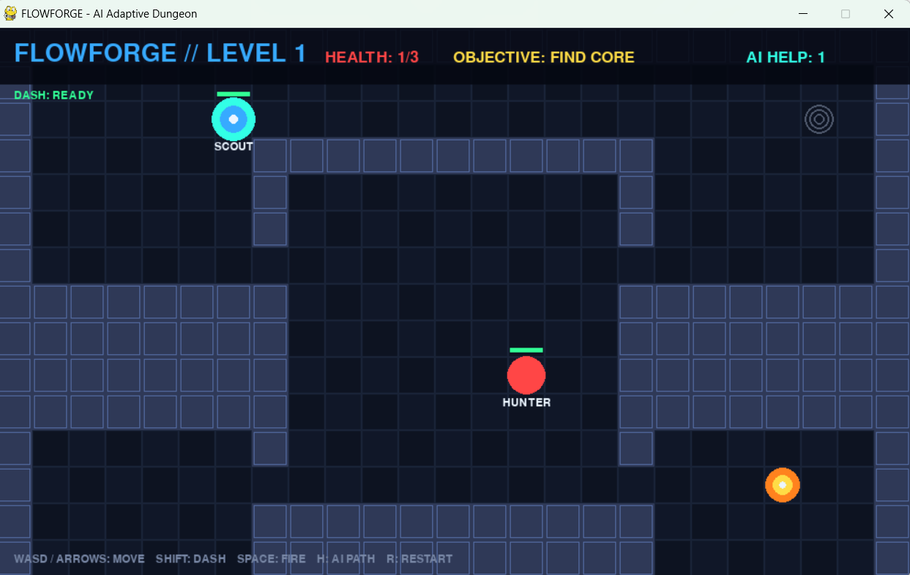
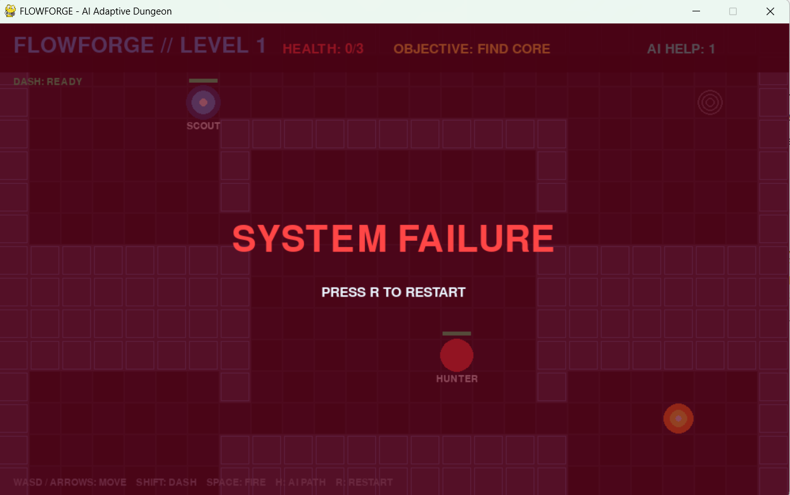
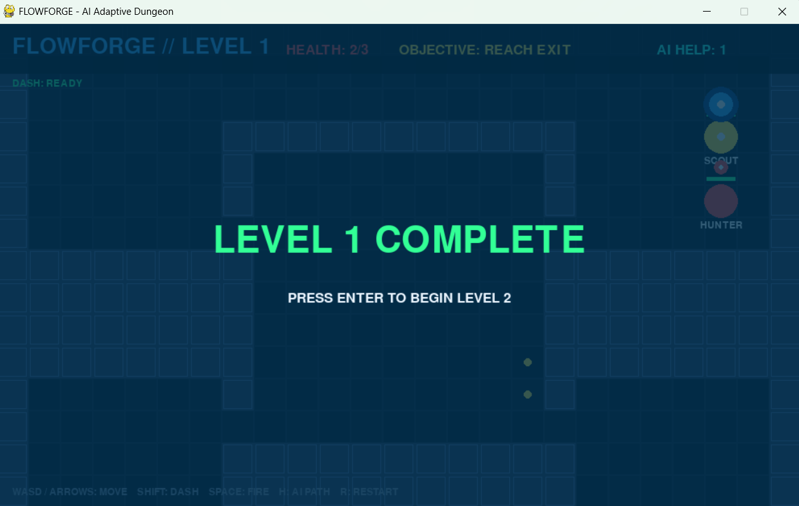
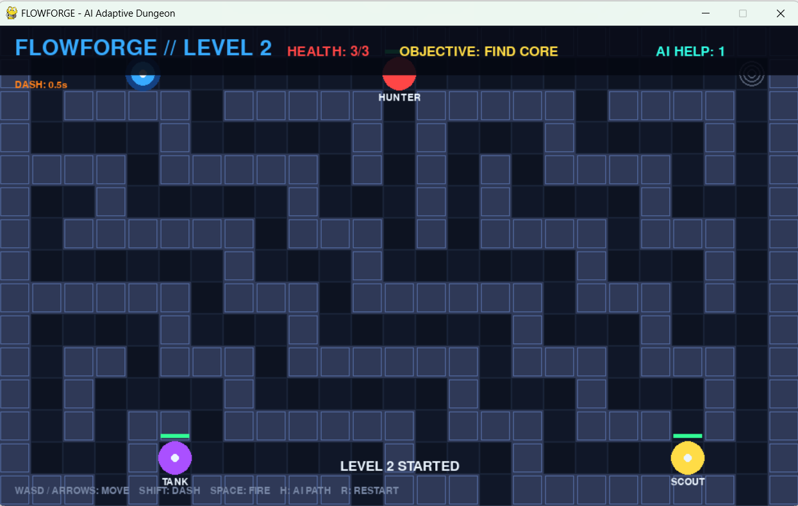

# 🎮 FlowForge — Intelligent Dungeon Escape Game

<p align="center">
  <strong>An AI-Driven 2D Dungeon Adventure Built with Python and Pygame</strong>
</p>

<p align="center">
  Navigate the dungeon. Outsmart your enemies. Collect the energy core. Escape alive.
</p>

<p align="center">
  
  
  
  
</p>

---

## 📌 About the Project

**FlowForge** is a playable, top-down 2D dungeon-escape shooter developed using Python and Pygame. The game combines action-based combat, maze navigation, and artificial intelligence-based pathfinding to create an interactive dungeon experience.

Players must explore dungeon levels, avoid enemy attacks, use combat abilities, collect an energy core, and reach the exit to complete their mission.

The central feature of FlowForge is its use of the **A* pathfinding algorithm** for enemy navigation and player guidance. Enemies can calculate routes around walls when pursuing the player, while an on-screen path hint helps players navigate towards the current objective.

The project demonstrates the practical application of game loops, event handling, collision detection, enemy behaviour, level design, and pathfinding algorithms in a desktop gaming environment.

## 🎯 Project Objectives

- Develop a playable 2D dungeon game using Python and Pygame.
- Implement player movement, shooting, and dash mechanics.
- Apply A* pathfinding to support obstacle-aware enemy navigation.
- Provide navigation assistance through an on-screen path hint.
- Implement enemy behaviour, health management, and collision detection.
- Design multiple dungeon levels with collectible objectives and exits.
- Demonstrate the practical application of artificial intelligence in game development.

## ✨ Features

| Feature | Description |
|---|---|
| 🗺️ Dungeon Exploration | Navigate hand-designed dungeon maps containing walls and obstacles. |
| 🧠 A* Pathfinding | Calculate routes through the dungeon while accounting for obstacles. |
| 🧭 Path Hint | Display navigation guidance towards the current objective. |
| 🔫 Laser Combat | Shoot enemies and reduce their health. |
| ⚡ Dash Mechanic | Move rapidly through the dungeon with temporary invincibility. |
| ❤️ Health System | Manage player health while avoiding enemy contact and bullets. |
| 👾 Multiple Enemy Types | Encounter Hunter, Scout, and Tank enemies. |
| 🔋 Energy Core | Collect the required objective before escaping. |
| 🚪 Level Progression | Reach the exit after completing the required objective. |
| 🔄 Restart System | Restart the game after failure using the `R` key. |
| 🎨 Game Interface | Includes a heads-up display, rendering, visual effects, and audio integration. |

## 🕹️ Gameplay Overview

FlowForge is designed around objective-based dungeon exploration and combat.

### How to Play

1. **Explore the dungeon** — Move through the map while avoiding walls and obstacles.
2. **Defeat enemies** — Use your laser to damage hostile enemies.
3. **Avoid attacks** — Keep your distance from enemies and their bullets.
4. **Use dash strategically** — Escape dangerous situations using temporary invincibility.
5. **Collect the energy core** — Locate and collect the required objective.
6. **Reach the exit** — Escape after collecting the energy core.
7. **Survive** — If your health reaches zero, restart the game and try again.

### Gameplay Rules

- The player moves through a grid-based dungeon.
- Walls block movement.
- Laser attacks reduce enemy health.
- Dash moves the player up to three cells.
- Dash grants brief invincibility and has a 1.5-second cooldown.
- Enemy contact and bullets reduce player health.
- The player must collect the energy core and reach the exit to win.
- The game displays `SYSTEM FAILURE` when the player's health reaches zero.
- Press `R` to restart after failure.

## 🧠 Artificial Intelligence — A* Pathfinding

A* is a graph-search algorithm used to find a low-cost path between a starting position and a target position.

In FlowForge, pathfinding supports two main gameplay functions.

### 1. Intelligent Enemy Navigation

Enemies use pathfinding to identify routes around walls when pursuing the player. This helps overcome the limitations of simple straight-line movement in maze-like environments.

### 2. Player Navigation Assistance

The path-hint system helps players identify a route towards the current objective, reducing the difficulty of navigating complex dungeon layouts.

### How A* Works

1. Identify the starting position and destination.
2. Represent the dungeon as a grid containing walkable and blocked cells.
3. Explore possible routes using A* search.
4. Evaluate candidate positions using movement cost and a heuristic.
5. Reconstruct the selected path.
6. Use the path for enemy navigation or player guidance.

The Manhattan-distance heuristic is commonly used for grid-based movement:

\[
h(n)=|x_n-x_g|+|y_n-y_g|
\]

Where:

- \(x_n,y_n\) represent the current grid position.
- \(x_g,y_g\) represent the goal position.
- \(h(n)\) estimates the remaining distance to the goal.

A* evaluates positions using:

\[
f(n)=g(n)+h(n)
\]

Where:

- \(g(n)\) is the cost of reaching the current position.
- \(h(n)\) is the estimated remaining cost.
- \(f(n)\) is the combined evaluation score.

By combining actual movement cost with an estimated remaining distance, A* can efficiently search for routes through the dungeon.

## 👾 Enemy Types

FlowForge includes three enemy types:

| Enemy Type | Description |
|---|---|
| **Hunter** | Pursues the player and creates combat pressure. |
| **Scout** | Provides a different enemy behaviour to vary gameplay. |
| **Tank** | Represents a heavier enemy challenge. |

The exact health, speed, attack patterns, and behavioural differences are determined by the game implementation.

## 🛠️ Technology Stack

| Technology | Purpose |
|---|---|
| Python | Main programming language |
| Pygame | Game window, input handling, rendering, and gameplay |
| A* Search | Pathfinding and route calculation |
| Manhattan Distance | Grid-based heuristic |
| Git | Version control |
| GitHub | Source-code hosting and project presentation |

## 🏗️ Project Structure

```text
FlowForge/
│
├── main.py          # Main game loop, rendering, HUD, effects and audio
├── player.py        # Player movement, dash and health management
├── enemy.py         # Enemy types, behaviour and shooting
├── level.py         # Dungeon maps, level design and objectives
├── pathfinding.py   # Pathfinding implementation
├── README.md        # Project documentation
├── requirements.txt # Dependencies, if included
├── .gitignore       # Files excluded from version control
├── assets/          # Game resources, if included
└── screenshots/     # Gameplay screenshots, if included
```

*This is a representative structure. Update it to match the actual files and folders in your repository.*

## 💻 Installation and Setup

Follow these steps to run FlowForge on your computer.

### Prerequisites

- Python 3 installed.
- Git installed.
- Pygame and any additional dependencies required by the project.

### Step 1: Clone the Repository

```bash
git clone https://github.com/kommareddydinesh/FlowForge.git
```

### Step 2: Open the Project Directory

```bash
cd FlowForge
```

### Step 3: Create a Virtual Environment

On Windows PowerShell:

```powershell
python -m venv .venv
.\.venv\Scripts\Activate.ps1
```

If activation is blocked by your PowerShell execution policy, you can use Command Prompt and run:

```bat
.venv\Scripts\activate.bat
```

### Step 4: Install Dependencies

If `requirements.txt` exists:

```powershell
python -m pip install -r requirements.txt
```

If the project only requires Pygame:

```powershell
python -m pip install pygame
```

Install any other dependencies listed by the project.

### Step 5: Run the Game

```powershell
python main.py
```

The game window should open, allowing you to play the dungeon-escape game.

## 🎮 Controls

| Action | Control |
|---|---|
| Movement | Use the movement keys configured in the game. |
| Shooting | Use the configured shooting key or input. |
| Dash | Use the configured dash key or input. |
| Navigation | Follow the on-screen path hint. |
| Restart after failure | Press `R`. |

**Note:** Confirm the exact movement, shooting, and dash key bindings from your source code and update this table before publishing.

## 🧪 Testing and Validation

The following tests can be used to evaluate the main gameplay systems.

- [ ] The game launches without errors.
- [ ] Player movement works correctly.
- [ ] Walls block movement through occupied cells.
- [ ] Laser shooting damages enemies.
- [ ] Dash movement works as expected.
- [ ] Temporary invincibility and dash cooldown function correctly.
- [ ] Enemies navigate around walls.
- [ ] The path hint guides the player towards the objective.
- [ ] Enemy contact and bullets reduce player health.
- [ ] The energy core can be collected.
- [ ] Reaching the exit triggers the appropriate victory state.
- [ ] Zero health triggers the failure screen.
- [ ] Pressing `R` restarts the game after failure.

These checks should be performed during actual gameplay. Mark each item as complete only after verifying it.

## 📸 Screenshots

Screenshots of the running game help visitors understand the gameplay and verify the implemented features.

Create a `screenshots` directory and add your actual screenshots:

```text
screenshots/
├── gameplay.png
├── enemy_pathfinding.png
├── path_hint.png
└── level_complete.png
```

Then add the following section to display them.

## 📸 Gameplay Screenshots

### 🎮 Main Gameplay

Explore the dungeon, navigate obstacles, and encounter enemies.



### ❤️ Combat and Survival

Experience enemy encounters and manage your health while navigating the dungeon.



### 🧠 Enemy AI and Dungeon Navigation

Explore the dungeon environment and observe enemy interactions.



### 🏆 Gameplay and Level Progression

Experience the dungeon objectives and progression through the game.



## 📚 Learning Outcomes

Through this project, I explored and practised:

- Python programming for interactive applications.
- Pygame rendering and event handling.
- Game loops and real-time input processing.
- Grid-based dungeon design.
- Collision detection and health management.
- Enemy behaviour and state management.
- A* search and heuristic-based pathfinding.
- Gameplay testing and debugging.
- Version control using Git and GitHub.
- Technical documentation for software projects.

## 🚀 Future Enhancements

Possible improvements for future versions include:

- Additional dungeon levels and environments.
- More enemy behaviours and attack patterns.
- Adjustable difficulty settings.
- Improved pathfinding visualisation.
- Additional weapons and player abilities.
- High-score tracking and save functionality.
- Enhanced animations, sound effects, and visual effects.
- Automated gameplay testing.

These are proposed future improvements rather than claims about currently implemented functionality.

## 👨‍💻 About the Developer

**K. Dinesh Raj Pal Reddy**

- **Registration Number:** URK23CS7107
- **Course:** B.Tech — Computer Science and Engineering (AI & ML)
- **Project:** FlowForge — An Intelligent Dungeon Escape Game Using A* Pathfinding
- **Subject:** Game Development

This project was developed as part of my Game Development coursework to explore Python-based game development and the application of artificial intelligence techniques in interactive environments.

The project focuses on gameplay mechanics, dungeon navigation, enemy behaviour, pathfinding, collision detection, health management, and level progression.

### 🎯 Project Goals

- Build a playable 2D dungeon-escape game.
- Apply A* pathfinding to enemy navigation and player guidance.
- Integrate combat, dash mechanics, health management, and level objectives.
- Apply game development concepts through a functional Python application.

---

<p align="center">
  <strong>FLOWFORGE</strong>
  <br/>
  Find the path. Defeat the enemies. Escape the dungeon.
  <br/><br/>
  Built with Python and Pygame.
</p>
